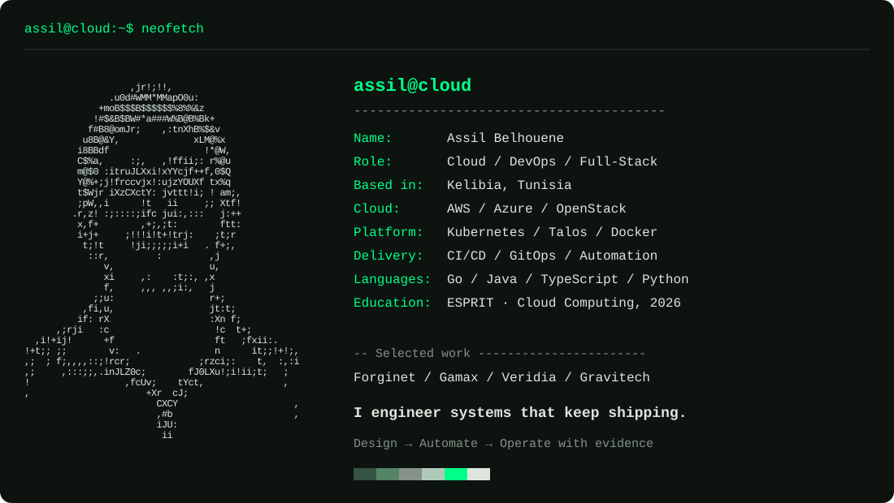

<picture>
  <source media="(max-width: 640px)" srcset="assets/hero-mobile.svg">
  
</picture>

  <a href="https://assil-belhouene-portfolio.vercel.app/">Portfolio</a> &nbsp; / &nbsp;
  <a href="https://assil-belhouene-portfolio.vercel.app/assil-belhouene-cv.pdf">CV</a> &nbsp; / &nbsp;
  <a href="https://www.linkedin.com/in/assil-belhouene/">LinkedIn</a> &nbsp; / &nbsp;
  <a href="mailto:assil.belhouene@gmail.com">Email</a>

### `01 / whoami`

I'm **Assil Belhouene**, a Cloud, DevOps, and Full-Stack Engineer based in **Kelibia, Tunisia**. I build cloud-native platforms and full-stack systems that turn repetitive operational work into dependable automation.

My favorite engineering problems sit between the product and the platform: **visual workflows, Kubernetes orchestration, delivery automation, identity, observability, and runtime security**.

**Design the workflow. Automate the platform. Operate with evidence.**

### `02 / selected work`

**[Forginet ↗](https://assil-belhouene-portfolio.vercel.app/projects/forginet)** — *Visual CI/CD, Kubernetes-native execution*

My final-year project at **BIAT IT**: a low-code delivery platform connecting a visual pipeline editor to versioned workflows, reusable actions, approval gates, live execution status, and streaming workload logs.

`Next.js` · `Spring Boot` · `Go` · `PostgreSQL` · `Kubernetes`

**[Gamax ↗](https://assil-belhouene-portfolio.vercel.app/projects/gamax)** — *Gaming as a service*

A cloud-gaming platform combining Spring Cloud services, image automation, OpenStack infrastructure, and Azure Kubernetes Service.

`Spring Cloud` · `Eureka` · `Feign Client` · `OpenStack` · `Azure AKS`

**[Veridia ↗](https://assil-belhouene-portfolio.vercel.app/projects/veridia)** — *AWS media delivery*

A media streaming application built with AWS compute and storage services, with Redis-backed content caching.

`AWS EC2` · `S3` · `Lambda` · `Redis` · `IAM`

**[Gravitech ↗](https://assil-belhouene-portfolio.vercel.app/projects/gravitech)** — *Infrastructure, made visible*

My internship project at **Vermeg**: a responsive MERN application for datacenter asset management, real-time updates, and interactive Three.js views of racks and servers.

`MongoDB` · `Express.js` · `React` · `Node.js` · `Three.js`

[Explore all project case studies →](https://assil-belhouene-portfolio.vercel.app/projects)

### `03 / toolbox`

**Cloud & infrastructure**

Kubernetes · Talos Linux · Docker · AWS · Azure / AKS · OpenStack · Terraform · Ansible · Helm · Kustomize · Argo CD

**Delivery & security**

GitHub Actions · Jenkins · SonarQube · Trivy · Semgrep · CodeQL · Syft · Grype · OWASP ZAP · Kyverno · Kubeconform

**Observability & testing**

Prometheus · Grafana · Alertmanager · Loki · Grafana Alloy · Falco · k6

**Application development**

Java · Go · TypeScript · Python · Bash · PowerShell · Spring Boot · Spring Cloud · Next.js · React · Node.js · PostgreSQL · MongoDB · Redis · Keycloak

### `04 / foundations`

**ESPRIT School of Engineering** — Engineering Degree in Cloud Computing, 2026

- AWS Certified Cloud Practitioner
- Aviatrix Multicloud Network Associate
- CCNA: Switching, Routing, and Wireless Essentials

Arabic · English · French

### `05 / ping assil`

Have a cloud, DevOps, platform, or full-stack engineering problem to work through? **[Let's build reliable systems.](mailto:assil.belhouene@gmail.com)**

[assil.belhouene@gmail.com](mailto:assil.belhouene@gmail.com) · [LinkedIn](https://www.linkedin.com/in/assil-belhouene/) · [assil.cloud / portfolio](https://assil-belhouene-portfolio.vercel.app/)

---

> Engineering is the art of productive laziness.

The portrait above is made from ASCII characters, converted from my photograph. [View the plain-text portrait](assets/portrait.txt) · [Artwork notes](ARTWORK.md)
